# TANTARA

TANTARA is a local-first workspace for arbitration matters. It combines case and client management, document ingestion, cited legal research, drafting, filing bundles, calendar, tasks, and community tools in one authenticated application.

## Architecture and data flow

The browser uses the Next.js workspace. API requests go through its same-origin `/api/v1` rewrite to FastAPI. SQLAlchemy stores owner-scoped records in SQLite; uploaded files and generated paperbooks live under the configured workspace data directory. Ingestion extracts text and page metadata, then updates both the full-text index and the vector index. Research filters evidence by owner and selected collections before ranking it. Answers retain source citations; an unavailable generation model is reported as unavailable rather than presented as a grounded answer.

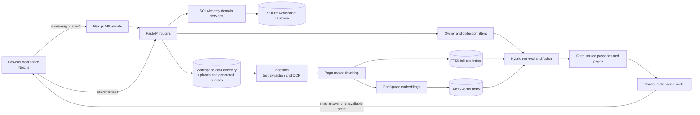

## Repository layout

- `frontend/` — Next.js application, UI modules, and Playwright end-to-end tests.
- `backend/app/` — FastAPI application, domain models, API routers, and retrieval services.
- `backend/alembic/` — database migrations.
- `scripts/` — workspace seeding and development utilities.
- `docs/` — API notes, integration reports, design references, and current screenshots.

## Local development

Use Python 3.11 or newer, Node.js, and pnpm. From the repository root, install the backend and frontend dependencies:

```bash
python -m venv backend/.venv
backend/.venv/bin/pip install -r backend/requirements-dev.txt
cd frontend && pnpm install
```

In a backend terminal, set a new workspace directory, seed its demo data once, and start the API:

```bash
cd /path/to/tantara
export TANTARA_DATA_DIR="$PWD/.tantara-data"
export DATABASE_URL="sqlite:///$TANTARA_DATA_DIR/tantara.db"
backend/.venv/bin/python scripts/seed.py --demo
cd backend
../backend/.venv/bin/python -m uvicorn app.main:app --host 127.0.0.1 --port 8010
```

The demo seeder refuses to append to an existing populated workspace. Keep the data directory if you want to keep its data; use a new directory for a separate demo workspace.

In another terminal, start the frontend. It uses the same-origin API rewrite, which defaults to the local API above:

```bash
cd /path/to/tantara/frontend
TANTARA_API_ORIGIN=http://127.0.0.1:8010 pnpm dev
```

Open `http://127.0.0.1:3010`. The workspace timezone defaults to `Asia/Kolkata`; configure it with `TANTARA_WORKSPACE_TIME_ZONE` when needed. AI provider and embedding settings are read from the backend environment. The application reports unavailable model services in the UI.

## Validation

```bash
cd frontend
pnpm lint
pnpm typecheck
pnpm build
pnpm exec playwright test

cd ../backend
../backend/.venv/bin/python -m pytest -q --cov=app
```

Playwright starts an isolated migrated and demo-seeded backend and frontend using the configured test origins. Its test API origin is `TANTARA_API_ORIGIN`; the web origin is `TANTARA_WEB_URL`.

## Workspace screenshots

These desktop and mobile captures come from the authenticated, demo-seeded workspace. Dimensions and file sizes were checked against the referenced files when this table was added.

| Module | Desktop (1440×900) | Mobile (390×844) | Rendered | Captured (UTC) |
|---|---|---|---|---|
| Dashboard | 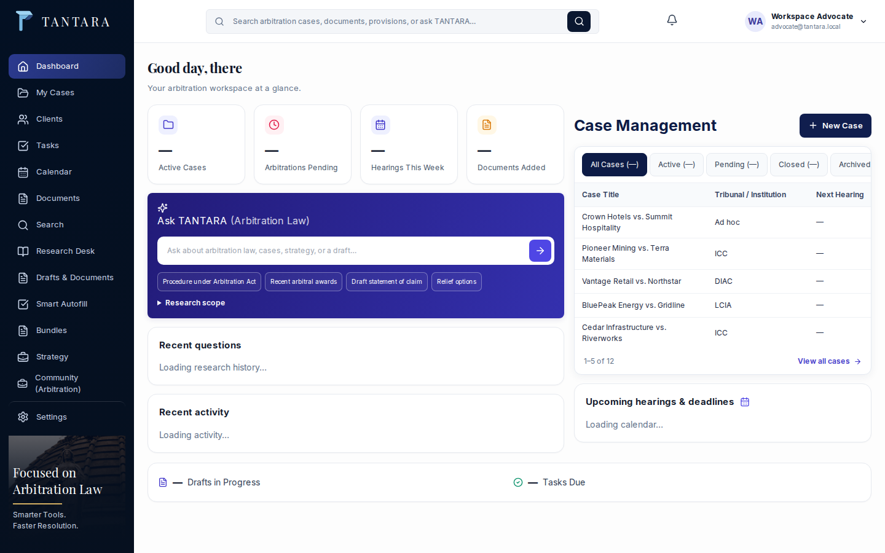 |  | 1440×900 / 390×844 | 10-28 12:29 |
| Cases |  | 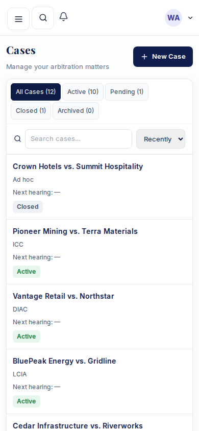 | 1440×900 / 390×844 | 10-28 11:59 |
| Clients |  |  | 1440×900 / 390×844 | 10-28 11:59 |
| Tasks | 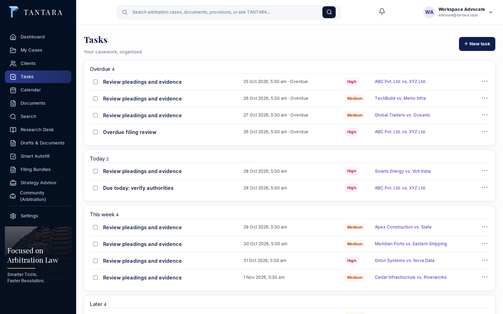 | 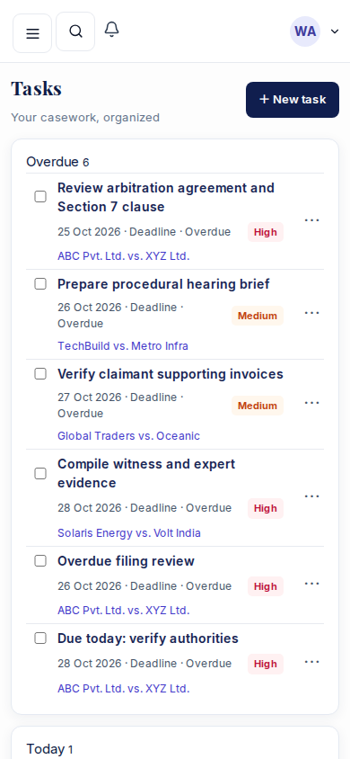 | 1440×900 / 390×844 | 10-28 12:29 |
| Calendar |  | 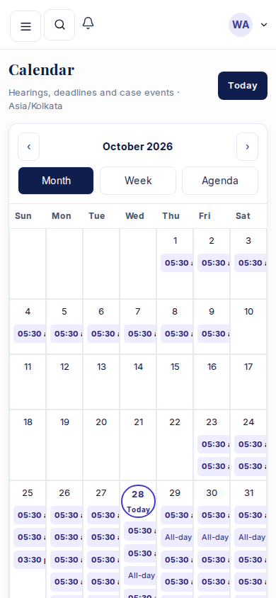 | 1440×900 / 390×844 | 10-28 12:29 |
| Documents |  | 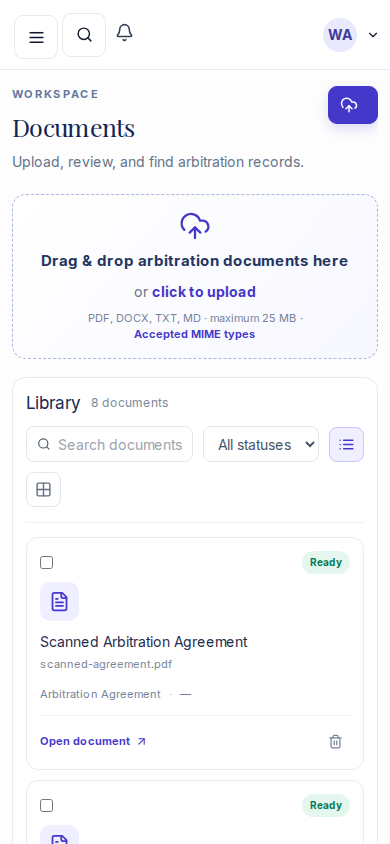 | 1440×900 / 390×844 | 10-28 11:59 |
| Search | 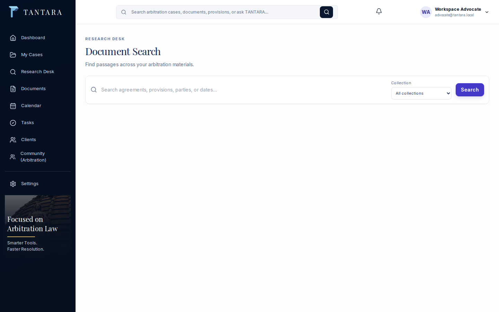 |  | 1440×900 / 390×844 | 10-28 12:06 |
| Research | 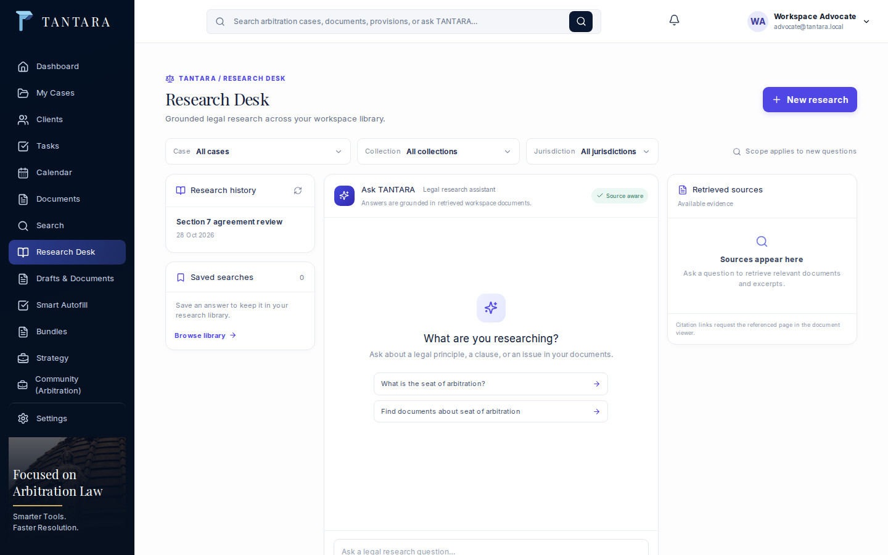 |  | 1440×900 / 390×844 | 10-28 11:59 |
| Drafts | 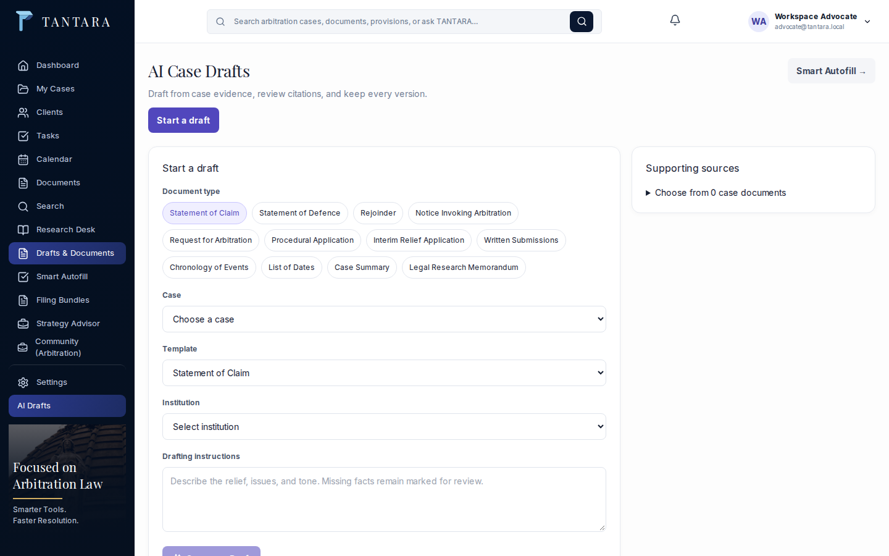 |  | 1440×900 / 390×844 | 10-28 11:59 |
| Autofill | 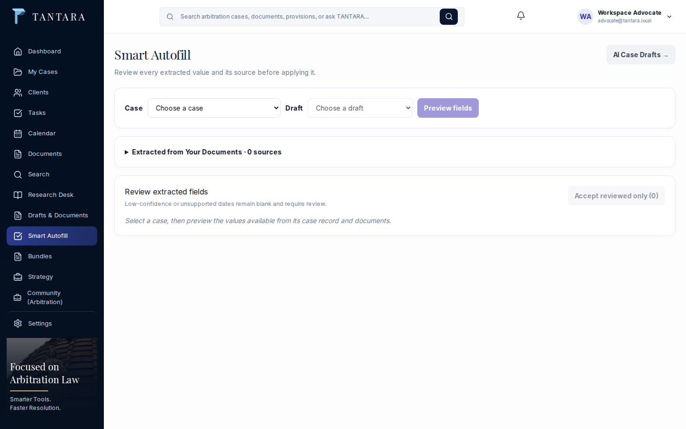 |  | 1440×900 / 390×844 | 10-28 12:06 |
| Bundles | 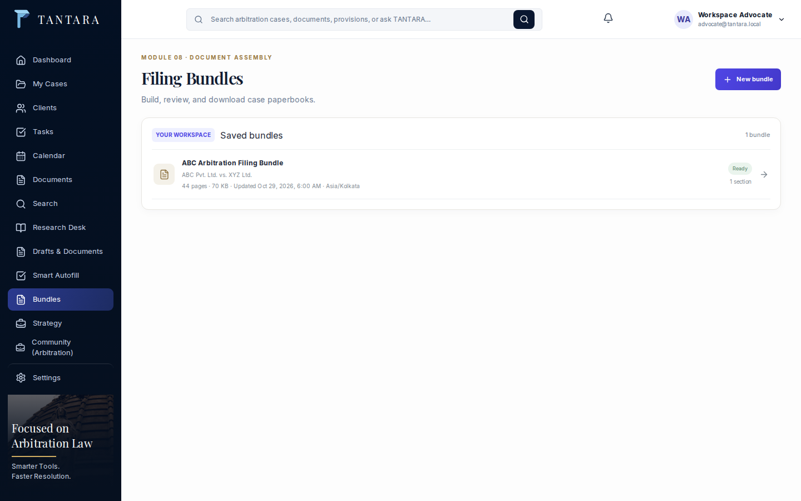 |  | 1440×900 / 390×844 | 10-28 11:59 |
| Strategy |  | 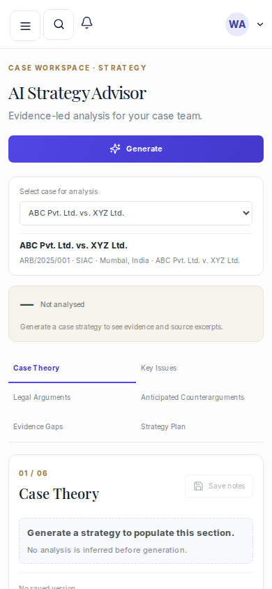 | 1440×900 / 390×844 | 10-28 12:06 |
| Community |  |  | 1440×900 / 390×844 | 10-28 11:59 |
| Settings | 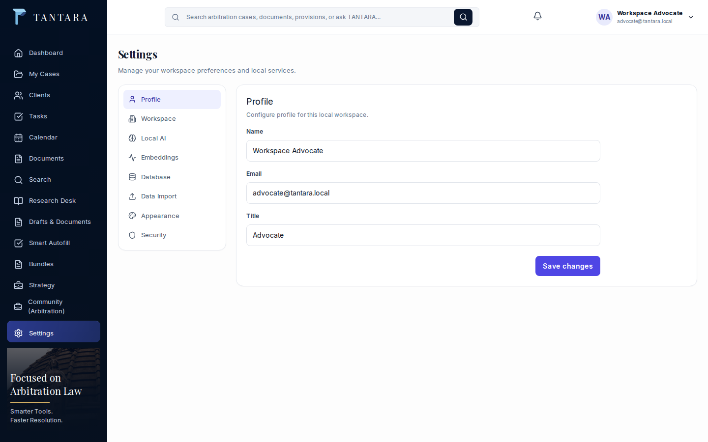 |  | 1440×900 / 390×844 | 10-28 11:59 |
